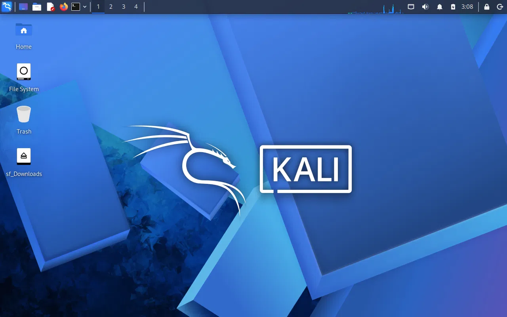
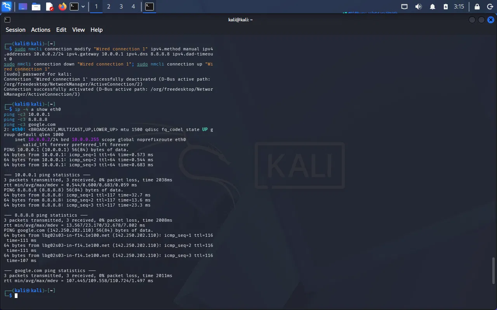

# NETWORKWALKS-HENDRICK-B084-WK1-PM1-CYBERSECURITY-LAB-SETUP
# 🔐 Cybersecurity Lab Environment Setup

**Building an isolated virtual lab for penetration testing and ethical hacking practice**

    

---

## 📌 Project Overview

This project sets up a **virtual cybersecurity and penetration-testing laboratory** using Virtual Box and Kali Linux on my own Windows laptop.

The lab runs on a private virtual network, so more machines can be added later and used as targets for **authorized** security testing only. Everything in this repository was done on my own devices inside my own lab. No third-party systems were touched.

- **Project:** Week 1 | Project Module 1 (WK1-PM1) – Practical Lab Environment Setup
- **Program:** Networkwalks Cybersecurity Internship, Batch B084
- **Author:** Hendrick Martin

---

## ✅ Requirements and Result

| Requirement | Status |
|---|---|
| VirtualBox as base (latest version) | ✅ VirtualBox 7.2.22 |
| Kali Linux as attacker VM (latest version) | ✅ Kali Linux 2026.3 (prebuilt VirtualBox image) |
| NATNetwork with 10.0.0.0/24 subnet | ✅ `NatNetwork`, DHCP enabled |
| Clipboard and drag/drop enabled | ✅ Bidirectional |
| Shared folder (Downloads from host) | ✅ Auto-mount enabled |
| Kali IP address 10.0.0.2/24 | ✅ Static IP set with NetworkManager |
| Kali has full Internet access | ✅ Verified with ping tests |
| Snapshot taken | ✅ `My Fresh Kali Linux after installation` |

---

## 🗺️ Lab Architecture

```
┌──────────────────────────── Host: Windows 11 ────────────────────────────┐
│                                                                          │
│   ┌──────────────────────── VirtualBox 7.2.22 ────────────────────────┐  │
│   │                                                                   │  │
│   │   NATNetwork  "NatNetwork"  10.0.0.0/24  (DHCP enabled)           │  │
│   │        │                                                          │  │
│   │   ┌────┴─────────────────────┐                                    │  │
│   │   │ Kali Linux 2026.3 (VM)   │  Static IP: 10.0.0.2/24            │  │
│   │   │ Attacker machine         │  Gateway:   10.0.0.1               │  │
│   │   └──────────────────────────┘  Internet via NAT                  │  │
│   └───────────────────────────────────────────────────────────────────┘  │
└──────────────────────────────────────────────────────────────────────────┘
```

**VM resources:** 4 GB RAM, 2 CPUs, 80 GB virtual disk.

---

## 🛠️ Tools and Versions

| Tool | Version |
|---|---|
| Host OS | Windows 11 |
| 7-Zip | latest (to extract the Kali image) |
| Oracle VirtualBox | 7.2.22 |
| Kali Linux | 2026.3 (VirtualBox amd64 image) |

---

## 🚀 Step-by-Step Setup

### Step 1: Install VirtualBox
Downloaded VirtualBox from the official site and ran the installer.


### Step 2: Download and extract the Kali Linux image
Downloaded the prebuilt **Kali Linux VirtualBox** image from kali.org and extracted the `.7z` archive with 7-Zip.


### Step 3: Add the Kali VM to VirtualBox
Added the extracted `.vbox` file with **Machine → Add**. This step gave an error, explained in [Troubleshooting](#-troubleshooting-problem-and-solution). After the fix, the VM appeared in the Machines list.


### Step 4: Create the NATNetwork (10.0.0.0/24)
**File → Tools → Network → NAT Networks → Create**, then set:

- Name: `NatNetwork`
- IPv4 Prefix: `10.0.0.0/24`
- Enable DHCP: ✔


### Step 5: Attach Kali to the NATNetwork
**Kali → Settings → Network → Adapter 1**:

- Attached to: `NAT Network`
- Name: `NatNetwork`
- Promiscuous Mode: `Allow All`


### Step 6: Enable clipboard and drag-and-drop
**Settings → General → Advanced**: Shared Clipboard and Drag-and-Drop both set to `Bidirectional`.


### Step 7: Increase RAM
Raised the base memory from 2048 MB to 4096 MB for a smoother desktop.


### Step 8: Share the host Downloads folder
**Settings → Shared Folders → Add**: host Downloads folder, Auto-mount enabled.


Inside Kali, add the user to the `vboxsf` group so the folder is accessible, then reboot:

```bash
sudo usermod -aG vboxsf $USER
sudo reboot
```

After the reboot, check the share is mounted:

```bash
ls -ld /media/sf_Downloads
```



### Step 9: Configure the static IP 10.0.0.2/24
Listed the connections to get the exact name:

```bash
nmcli connection show
```

Then set the static IP, gateway and DNS, and apply it:

```bash
sudo nmcli connection modify "Wired connection 1" ipv4.method manual ipv4.addresses 10.0.0.2/24 ipv4.gateway 10.0.0.1 ipv4.dns 8.8.8.8 ipv4.dad-timeout 0
sudo nmcli connection down "Wired connection 1"; sudo nmcli connection up "Wired connection 1"
```

### Step 10: Verify the IP and Internet access

```bash
ip -4 a show eth0
ping -c3 10.0.0.1
ping -c3 8.8.8.8
ping -c3 google.com
```

**Results:**

- `eth0` shows `10.0.0.2/24`
- Gateway `10.0.0.1`: 0% packet loss
- `8.8.8.8`: 0% packet loss
- `google.com`: 0% packet loss (DNS resolution works)



### Step 11: Take a snapshot
Shut the VM down and took a snapshot named **My Fresh Kali Linux after installation**, so the clean state can be restored at any time.


---

## 🧩 Troubleshooting: Problem and Solution

**Problem:** Adding the Kali `.vbox` file failed with `E_FAIL (0x80004005)`: *"Failed to open virtual machine… which has the same UUID as an existing virtual machine."*


**Cause:** The Kali VM was already registered in VirtualBox from an earlier attempt. The Manager window simply was not showing it, so adding it again clashed with the existing entry.

**Solution:**

1. Checked what VirtualBox had registered:
   ```
   "C:\Program Files\Oracle\VirtualBox\VBoxManage.exe" list vms
   ```
   Kali was already listed.
2. Confirmed its state and config path:
   ```
   "C:\Program Files\Oracle\VirtualBox\VBoxManage.exe" showvminfo "kali-linux-2026.3-virtualbox-amd64" --machinereadable | findstr /i "CfgFile VMState"
   ```
   It was registered and powered off.
3. Restarted VirtualBox Manager and opened the **Machines** view (the second icon in the sidebar, not the Home page). The VM was there, so no re-adding was needed.

**Lesson:** If a UUID error appears, check `VBoxManage list vms` first. The VM may already be registered.

---

## 🎓 What I Learned

- How to build an isolated lab with VirtualBox and a custom NAT network
- Static IP configuration on Kali with `nmcli`
- Why isolating attack machines from the real network matters
- How to verify connectivity (gateway, IP, DNS) step by step
- Using snapshots as a safe restore point
- Reading VirtualBox errors and diagnosing them with `VBoxManage`

---

## ⚖️ Ethical Use Notice

This lab is for **education and authorized practice only**. All testing is done on my own devices and virtual machines in my own lab. Unauthorized access to systems you do not own or have written permission to test is illegal.

---

*Networkwalks Cybersecurity Internship | Batch B084 | Week 1 Project 1*
